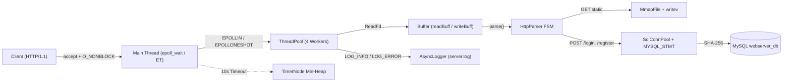
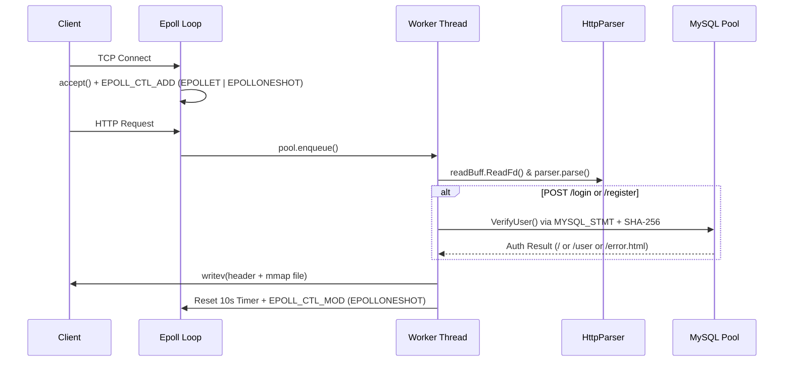
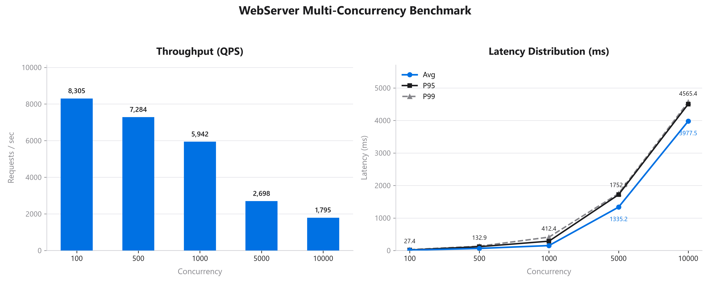

# C++ Epoll WebServer

基于 Linux C++14 构建的高并发轻量级 HTTP Web 服务器，采用 **Epoll 边缘触发（ET）+ 线程池** Reactor 模型，结合有限状态机 HTTP 解析、`mmap` + `writev` 静态资源零拷贝响应、MySQL 预处理连接池认证以及双缓冲异步日志。

---

## 核心特性

- **I/O 多路复用与连接管理**（[epollserver.cpp](epollserver.cpp)）
  - 使用 `epoll_create1(0)` 监听事件，客户端套接字设置为非阻塞（`O_NONBLOCK`）并启用 `EPOLLET | EPOLLONESHOT`，处理完一次可读事件后通过 `EPOLL_CTL_MOD` 重新挂载 `EPOLLIN | EPOLLONESHOT`。
  - 默认返回 `Connection: keep-alive` 长连接，并基于小根堆（`std::priority_queue<TimerNode>`）维护 **10,000 ms（10 秒）** 过期定时器，主循环定期清理超时连接。
- **固定大小线程池**（[Threadpool.h](Threadpool.h)）
  - 主线程仅负责 `accept` 与事件分发，业务解析与响应写回交由 `ThreadPool pool(4)` 异步执行。
- **有限状态机 HTTP 解析器**（`HttpParser` in [epollserver.cpp](epollserver.cpp)）
  - 支持 `STATE_REQUEST_LINE` → `STATE_HEADER` → `STATE_BODY` → `STATE_FINISH` 四态流转，通过循环解析支持 HTTP 粘包 / Pipeline 请求，并解析 `Content-Length` 读取 `POST` 表单体。
- **静态资源内存映射与集中写**（`MmapFile` in [epollserver.cpp](epollserver.cpp)）
  - 静态页面（`/` → `index.html`、`/user` → `user.html`、`/error.html` → `error.html`）通过 `mmap(PROT_READ, MAP_PRIVATE)` 映射至用户态只读内存，配合 `writev(client_fd, iov, 2)` 将响应头与文件体一次系统调用发出。
- **用户认证与 MySQL 连接池**（[sqlConnPool.h](sqlConnPool.h)、[crypto_util.h](crypto_util.h)）
  - `SqlConnPool` 维护默认 10 条 MySQL 长连接，通过 `SqlConnRAII` 自动归还句柄；`VerifyUser` 使用 `MYSQL_STMT` 参数绑定防 SQL 注入，密码经加盐 SHA-256（`OpenSSL SHA256`）后入库与比对。
- **双缓冲异步日志**（[AsyncLogger.h](AsyncLogger.h)）
  - `AsyncLogger` 采用 `current_buffer` 与 `next_buffer` 双缓冲队列，后台线程每 3 秒或缓存超过 100 条时批量刷盘至 `server.log`。

---

## 系统架构与请求生命周期





---

## Linux 编译与运行

### 1. 环境依赖
- GCC / Clang（支持 C++14）
- CMake >= 3.10
- MySQL Client 开发库（`libmysqlclient-dev`）
- OpenSSL 开发库（`libssl-dev`）

### 2. 数据库准备
确保本地 MySQL 运行在 `127.0.0.1:3306`，存在数据库 `webserver_db` 及 `users` 表（对应 `epollserver.cpp` 中的 `Init("127.0.0.1", 3306, "root", "123456", "webserver_db", 10)`）：

```sql
CREATE DATABASE IF NOT EXISTS webserver_db;
USE webserver_db;
CREATE TABLE IF NOT EXISTS users (
    id INT AUTO_INCREMENT PRIMARY KEY,
    username VARCHAR(64) NOT NULL UNIQUE,
    password CHAR(64) NOT NULL
);
```

### 3. 编译与启动

```bash
mkdir -p build && cd build
cmake ..
make -j$(nproc)
# 确保静态页面 (index.html, user.html, error.html) 位于当前工作目录
./webserver
```

服务默认监听 `8080` 端口：
- 主控台：`http://127.0.0.1:8080/`
- 登录 / 注册页：`http://127.0.0.1:8080/user`
- 错误提示页：`http://127.0.0.1:8080/error.html`

---

## 多梯度并发压测与可视化

`benchmark/` 目录提供了基于 Python `asyncio` + `aiohttp` 的多梯度压测脚本与 Apple 浅色极简风格绘图套件：

```bash
pip install aiohttp matplotlib

# 1. 运行 100 / 500 / 1000 / 5000 / 10000 并发梯度压测，输出 benchmark/results.json
python benchmark/bench.py --url http://127.0.0.1:8080/ --duration 5

# 2. 生成双子图性能报告 benchmark/benchmark_chart.png
python benchmark/plot_bench.py
```

### 压测图表展示



### 压测数据对比表（示例模板）

| 并发数 (Concurrency) | 吞吐量 (QPS) | 平均延迟 (ms) | P95 延迟 (ms) | P99 延迟 (ms) | 成功请求数 | 错误数 |
|---:|---:|---:|---:|---:|---:|---:|
| 100 | - | - | - | - | - | - |
| 500 | - | - | - | - | - | - |
| 1000 | - | - | - | - | - | - |
| 5000 | - | - | - | - | - | - |
| 10000 | - | - | - | - | - | - |
